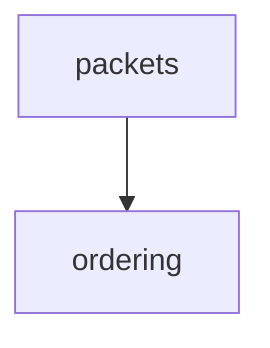

# The vault — lesson log + tutor tracking

Replaces the original `md-log` extension (which auto-mirrored the session into a linked markdown file). Here there is no extension: **you write the files yourself**, as you go.

## Where

Vault root: the folder in `$OBSIDIAN_VAULT_PATH` (written `<vault>` below). If unset, ask the learner once.

```
D:\V A U L T\
└── StudyVault\
    ├── dashboard.md              ← generated by learn.py render (never hand-edit)
    ├── .learn\                   ← learn.py's data (events log, config, cache)
    ├── concepts\
    │   └── <area>.md             ← per-area concept tracking
    ├── <Area>\                   ← one folder per subject area
    │   └── YYYY-MM-DD - topic.md ← the lesson log
    └── viz\                      ← images produced by the visualize skill
```

The `StudyVault/` name and the dashboard/concepts layout are **not arbitrary** — `learn.py` (the v3 retention engine) reads and writes them, and `/tutor` drills from the same data. Do not rename them.

`<Area>` is a short subject name (`Networking`, `Linear Algebra`, `Rust`). The folder name and the concepts filename must match: area `Networking` → `StudyVault/Networking/` + `StudyVault/concepts/Networking.md`.

Paths contain spaces — quote them in every Bash/PowerShell call. If `D:` is not mounted, say so and ask where to write instead; don't silently fall back to another location.

## Phase 0 — opening the log

1. Check `<vault>/StudyVault/` exists; create it and `concepts/` if not.
2. Decide the area. Reuse an existing folder if the topic fits one; otherwise create a new area folder.
3. Create the lesson file `StudyVault/<Area>/YYYY-MM-DD - <topic>.md` with front matter:

```markdown
---
area: Networking
date: 2026-08-25
goal: (filled in after Phase 1b)
---

# <Topic>

```

4. Run `learn.py lesson start --area <Area> --path "<Area>/<file>.md"` and keep the `lesson_id`. Don't create concept or dashboard files by hand; `learn.py render` makes them.

## Mirroring the lesson

After each teaching turn, **append what you just said** to the lesson file — verbatim prose, LaTeX, mermaid blocks, image embeds. Not a summary: the log's value is that it is the lesson, re-readable months later. Append per turn, never batched at the end.

Structure it as you go:

- `## Plan` — the prose approach + the mermaid dependency map from Phase 2.
- `## Node 1 — <name>` … one section per node, containing the motivate / establish / connect text.
- Quiz checks go in as a small block: the question, their answer, ✓/✗, and the explanation.
- `## Still shaky` — the Phase 4 closing note.
- `## Session pulse` — hit rate, hardest moment, clicks, open loop (see `engagement.md`).

Obsidian renders LaTeX and mermaid natively, so write both directly:

````markdown

````

Images from the `visualize` skill are embedded with a wikilink and a width — Obsidian resolves them by filename from anywhere in the vault:

```markdown
![[viz-tcp-stack-1756137600.svg|500]]
```

Interactive explorables (`.html`, from the `visualize` skill) are linked, not embedded — clicking the link opens the page inside Obsidian via the HTML Reader-plus plugin:

```markdown
> [!example] Interactive — expectancy explorer
> [[viz-expectancy-1790380800.html|▶ Open the explorable]] — predict first, then play with the sliders.
```

## Tracking (v3): owned by `learn.py`

The concept tables and the dashboard are **generated views**. Don't write them by hand.

```
StudyVault/
├── .learn/
│   ├── events.jsonl    ← append-only source of truth (every concept, item, attempt, grade)
│   ├── config.json     ← FSRS config versions, budgets, courses + exam dates
│   ├── state.json      ← cache (read by the session-start nudge)
│   └── answers\        ← verbatim answers, one file per attempt
├── concepts\<Area>.md  ← generated by `learn.py render`
├── concepts\_v2-archive\ ← the old hand-written v2 trackers (read-only history)
└── dashboard.md        ← generated by `learn.py render`
```

During a lesson:
- **New node** → `learn.py concept add --area <Area> --name "<the thing understood>" --lesson "<Area>/<file>.md" --stage 1`. Name concepts at the node grain, phrased as the thing understood ("why TCP needs sequence numbers").
- **In-lesson quiz-check graded** → `learn.py formative <concept_id> --outcome correct|incorrect --note "<the confusion, quoted>"`. The note becomes the error note in the generated table.
- **Node locked** → draft its item (`retention.md` → "Writing an item").
- **Close** → verify + `lesson finalize`, then `learn.py render`.

**Courses and exams** (degree work): add each course to `.learn/config.json` under `courses` as `{"<name>": {"area": "<Area>", "exams": ["YYYY-MM-DD"], "week1": "YYYY-MM-DD"}}`, and put `course` and `week` on its items. The script then caps intervals before exams and keeps older weeks in the problem mix.

## Handing off to /tutor

`/tutor` calls `learn.py`, which knows the vault path. There's no globbing, and it works from any directory. When reviews are due, a one-line reminder appears at session start.
