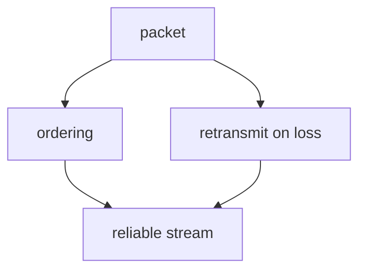

# Visualize

A picture earns its place only when it shows something words can't — shape, structure, direction, relationship, geometry. This skill produces ONE such picture, guarantees it is **correct**, and drops it into the lesson so it renders inline in the Obsidian log.

You are the **creative director**: you decide the exact idea and distill it to its fewest carrying elements.

## When to visualize (and when not to)

The `teach` system builds a **dependency graph in the learner's head** — unconditional truths at the root, derived facts hanging off them. A visual is powerful exactly when it makes that structure (or a geometry) visible. Reach for one when:

- The idea is a **structure or relationship**: dependencies, a system with parts and arrows, a flow/pipeline, a sequence of exchanges, a state machine, a tree/hierarchy, a comparison, a containment (what's inside vs outside).
- The idea is **spatial or geometric**: coordinate geometry, a number line, vectors, a function's shape, a physical arrangement.

Do NOT visualize when prose or a single equation already carries it. A decorative diagram that just restates the sentence next to it adds noise and a chance to be wrong. When in doubt, don't — a missing visual is cheaper than a false one.

## Evidence and the anti-passivity contract (v3)

- **When pictures pay off:** dual coding helps most when the content is *inherently* spatial, structural or dynamic (computation graphs, geometry, data structures, a quantity that changes). "Imagery for text" in general is a weak technique (Dunlosky et al., 2013). So match the tool to the content: an explorable where watching something change delivers the click, a small mermaid for structure, and nothing for a sentence that is already clear.
- **Never passive.** Every explorable starts with a prediction the learner **types in chat** before the reveal, and that prediction is graded as a quiz. A page that is only played with is re-watching, and re-watching is not study.
- The learner asked for a visual per new concept. Keep doing that, choosing the lightest visual that shows the structure.

## Three paths

The original system dispatched a `mermaid-maker` or `svg-maker` subagent that rendered a PNG and *looked at it* before returning. Claude Code doesn't need the rendering pipeline — Obsidian renders mermaid natively, and SVG embeds directly — but it also doesn't get that free verification. So verification becomes an explicit step you own (see below).

### Path A — mermaid (default)

For anything **nodes-and-edges**: dependency graphs, flowcharts, sequence/state/ER/class diagrams, trees, mindmaps, timelines. This fits the dependency-graph pedagogy directly, so it's the default.

Write the mermaid block **straight into the lesson file and into your chat reply**. No file, no subagent:

````markdown

````

Obsidian renders it natively; the terminal shows the source, which is fine.

### Path B — SVG

For **positions-and-shapes**: exact coordinates, geometry figures, number lines, vectors, plots, custom layouts that Mermaid's auto-layout can't express.

Use the `diagram-maker` skill to author it, then save the `.svg` into `<vault>/StudyVault/viz\viz-<slug>-<unix-timestamp>.svg` and embed it by filename:

```markdown
![[viz-triangle-similarity-1756137600.svg|500]]
```

Unique timestamped filenames keep Obsidian's by-filename embed resolution unambiguous.

### Path C — interactive explorable (HTML, 3Blue1Brown style)

For the idea where **watching something change** delivers the click: a quantity that depends on others, a process that unfolds step by step, a mechanism with a dial on it. The learner is strongly visual, so every lesson on a new subject gets at least one of these.

**Start from the template:** `~/.claude/skills/visualize/templates/explorable.html` (a finished, tested explorer for trading expectancy). Copy it, keep the engine and runtime sections, and rewrite only the `scenes` array and the `<h1>`/`<title>`. Save to `<vault>/StudyVault/viz\viz-<slug>-<unix-timestamp>.html` and link it from the lesson (not embed):

```markdown
> [!example] Interactive — <what it shows>
> [[viz-<slug>-<ts>.html|▶ Open the explorable]] — predict first, then play.
```

It opens inside Obsidian via the **HTML Reader-plus** plugin (sandboxed web view, scripts run). In the browser it works too.

**The 3B1B rules — what makes it high quality:**

1. **Scenes, not a dashboard.** 2–4 scenes, one idea each, in the order *hook → build → generalise*. Scene 1 is a concrete surprising case; the last scene is the general law.
2. **Predict before reveal — always.** Each scene poses a prediction question; the learner types it **in chat** (it's a graded quiz there, see `teach/references/quiz.md`), then clicks Reveal. Sliders stay locked until after the reveal — play comes after commitment.
3. **Show the mechanism geometrically.** Find the picture where the formula *is* the shape (expectancy = net area; a derivative = a slope you can see; a probability = a fraction of a region). If the visual is just a chart of a formula's output, dig for the geometric version.
4. **Colour = meaning, consistently.** Dark canvas; blue `#58c4dd` for the main object, yellow `#ffd95a` for the thing under attention, green `#83c167` / red `#fc6255` for good/bad or +/−. One colour never means two things.
5. **Smooth, purposeful motion.** Animate transformations with the eased `tween` (≈1–4 s), never jump-cut the key change. Motion shows *what changed into what*; no decorative animation.
6. **Continuous parameters.** After the reveal, give 1–2 sliders (or drag handles) on the variables that matter, with live numbers. Feeling the dependency with your hands is the point.
7. **Minimal text, math in KaTeX.** Narration ≤ 3 short sentences per scene; the insight card states the law in one line of LaTeX plus one sentence of meaning.
8. **Self-contained.** Everything inline except KaTeX from jsdelivr (degrades to raw `$…$` offline). No other network calls.

**Verify before linking — mandatory:**

- Every number in narration and insight is recomputed, not eyeballed (the template's claims — $+5R$, $+40R$, $w = 1/(1+R)$, 66.7% — were each checked by hand).
- Run it headless and look at it: the scratchpad test pattern is `puppeteer-core` driving Brave (`C:/Program Files/BraveSoftware/Brave-Browser/Application/brave.exe`), clicking Reveal on every scene, collecting `pageerror`/console errors, and screenshotting each scene. Read the screenshots. Zero JS errors and every scene legible, or it doesn't ship.

## One idea, fewest elements

The most common failure is **cramming** — every extra label makes the picture harder to read AND harder to lay out correctly. Before drawing, prune to the fewest elements that carry the idea, and for each ask: *"if I delete this, is the idea still clear?"* If yes, delete it.

If you're about to draw more than ~7 nodes, stop and simplify. A diagram of 4 nodes that each pull weight beats one of 12 that fight for space.

Be concrete about what the picture must show, not vague about the topic:

- BAD: "a diagram about how TCP works"
- GOOD: "`graph TD`: node `packet` at top; arrows down to `ordering` and `retransmit on loss`; both arrows down into `reliable stream`. No title. Shows that reliability is built FROM packets, not alongside them."

## Verify before you embed

Nothing renders the picture back to you here, so **correctness is entirely on you**. Before the block goes in the lesson, check it deliberately:

- **Every arrow points the right way.** Is each dependency actually true — does A really derive from B, or did you draw it backwards? A wrong edge is worse than no diagram: it plants a false connection in exactly the graph you're trying to build correctly.
- **Every label is correct and unambiguous**, and short — a term or short phrase, never a sentence. Long labels wreck mermaid layout.
- **The geometry is derived, not eyeballed** (SVG path): re-do the arithmetic for coordinates, angles, and proportions rather than guessing them.
- **Mermaid syntax is valid.** Watch the usual breakers: parentheses, quotes, or `-` inside node labels — wrap the label in `["..."]`. Reserved words like `end` need quoting. LaTeX does not work inside mermaid labels.
- **Would the learner read the intended idea from this picture alone?** If not, it's not carrying its weight.

If you can't make a correct, sensible picture of the idea, say so and skip the visual — don't ship a diagram you're unsure of.

## Then let it carry the idea

Introduce the visual in a sentence, then stop — don't narrate every element back in prose. The point of the picture is that it says what prose couldn't.

---

*Ported from [amosblomqvist/learn](https://github.com/amosblomqvist/learn).*
